import Link from '@docusaurus/Link';

The `vrsplayer` app plays VRS recordings as multi-stream video, with sound when playable audio is present. To build it, follow the [VRS build instructions](https://github.com/facebookresearch/vrs#getting-started) and install Qt (5 or 6) and PortAudio.

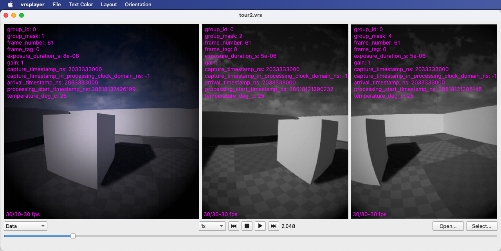

Choose File > Open Local File to open a recording. See [Image Support](./ImageSupport.md) for image formats and metadata conventions. To play H.265 (HEVC) video, build with XPRS enabled.

## Playback Controls

Use the controls below to play, pause, or stop playback.

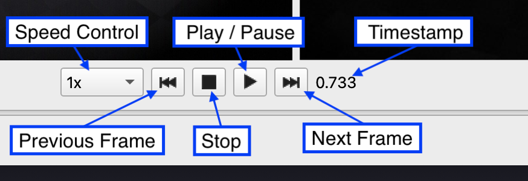

While paused, the Previous and Next Frame buttons step backward or forward by at most one frame per visible stream. The Speed control changes the playback speed. During playback, the player may drop frames to keep up.

## Overlay Selection

The overlay selector controls what appears over the frames. Choose "Hide" for no overlay, "Tags" for stream tags, or "Configuration", "State", or "Data" for metadata from the most recently read record of that type.

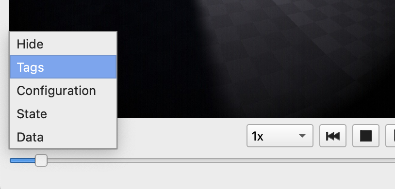

Use the Text Overlay menu to change the text color and font size or to toggle a solid background.

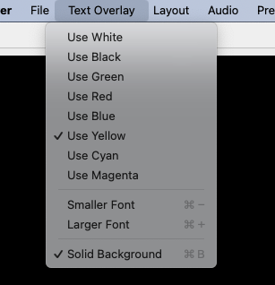

Pause playback to inspect a frame and its metadata without the overlay changing.

## Tooltips

Hover over the time display to see the playback duration.

The start and end times come from data records in image and playable audio streams. For example, if the only image stream has a configuration record at timestamp 0 and its first data record at timestamp 15, playback starts at 15.

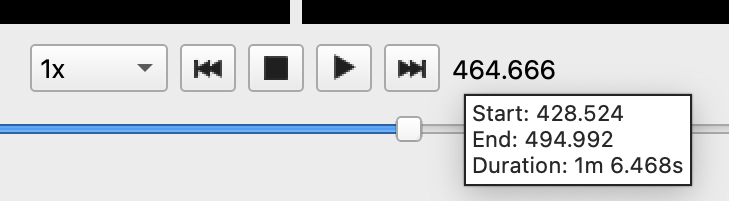

The tooltip over a frame shows the stream ID ("214-1"), the recordable type name ("RGB Camera Class"), and the stream flavor, if present ("device/aria"). It can also show the device type ("Simulated") from a configuration record or the `device_type` stream tag.

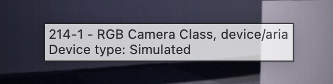

## Menu Bar Commands

Use File > `Save All Frames to...` to save the current frames from visible streams to a folder.

### Layout

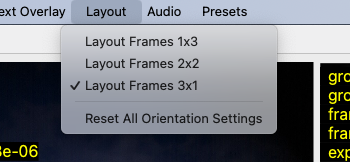

The `Layout` menu lets you set the number of streams per row. `Layout Frames 4x2` uses two rows with up to four streams per row. The available layouts depend on how many image streams are visible.

### Audio

For a stream with multiple audio channels, use the Audio menu to choose which channels to play. For example, a recording with seven audio channels might show this menu:

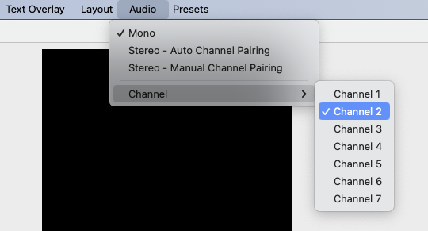

In Mono mode, you can listen to one channel at a time. On a stereo output device, the selected channel plays through both output channels.

With at least two input and two output channels, you can choose Auto Channel Pairing or Manual Channel Pairing.

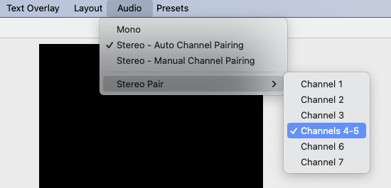

Auto Channel Pairing lets you select a first audio channel ("left"), and the next audio channel will automatically be used as the "right" channel. If that automatic selection is not what you need, use the Manual Channel Pairing option:

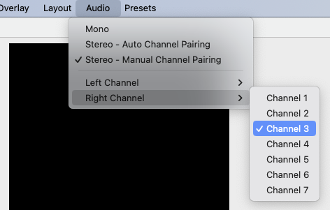

In this mode, you choose the left and right channels independently.

### Presets

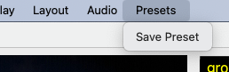

Use `Save Preset` in the `Presets` menu to save stream orientation, order, and visibility, along with your audio settings. To arrange the image streams, use the options in the Context Menu section below.

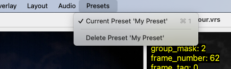

Use the `Presets` menu to recall a saved preset or delete the current one. The first nine preset entries get keyboard shortcuts.

## Context Menu

Right-click a stream to rotate, mirror, move, or hide it. Use `Save Frame As...` to save the current frame to a file.

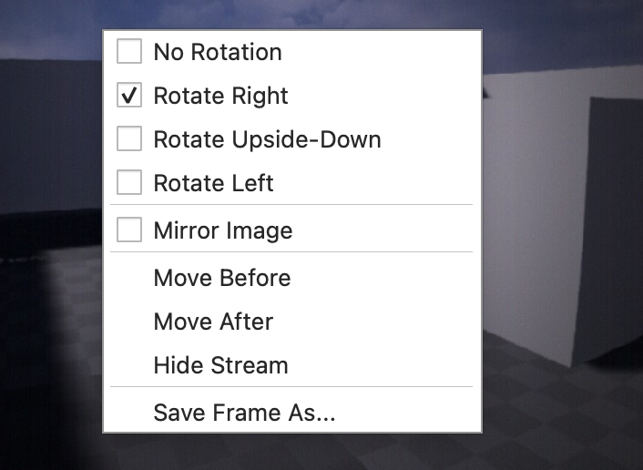

To restore hidden streams, choose `Show All Streams` from the `Layout` menu.

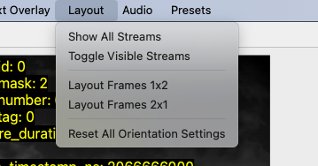

## Playback "fps" Display

During playback, the player follows the recorded timestamps and may drop frames to keep up. Each view can display up to three frame rates:

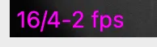

- the first number (16) is the rate at which image blocks are read for the stream. One reader thread handles record reads, lossless decompression, and `StreamPlayer` callbacks for all streams. For inter-frame video, decoding also happens on this thread.
- the second number (4) is the rate at which processed frames reach the view. Each stream has a worker thread for tasks such as decoding JPEG or PNG images and converting pixel formats for display. That worker can skip queued frames if it falls behind.
- the last number (2) is the rate at which the UI thread draws the view. Resizing the window can increase this rate even when playback is paused.

The draw rate measures redraws, not distinct frames. It can exceed the rate at which processed frames reach the view.

## Keyboard Playback Controls

Playback can be directly controlled from the keyboard:

- Use the space bar to play or pause.
- Use Backspace or Home to return to the playback start, like the Stop button.
- While paused, use Left or Right to step backward or forward by one frame set (at most one frame per visible stream).
- While paused, use Up or Down to jump backward or forward by up to 10 frame sets.
- While paused, use Page Up or Page Down to jump backward or forward by up to 100 frame sets.

To inspect frames individually, pause playback and step with Left or Right. The larger jumps skip intermediate frame sets.
